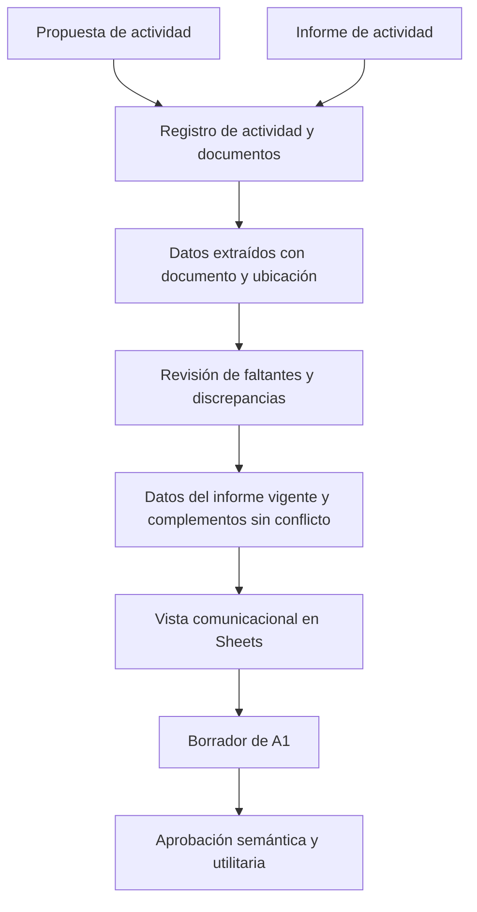

# Registro de actividades con propuesta e informe — v1

- **Fecha de relevamiento:** 2026-10-07.
- **Estado:** `CANDIDATO_PENDIENTE_VALIDACION_SEU`.
- **Decisión del 2026-10-12 ([#54](https://github.com/SpendIce/Proyecto-Final/issues/54)):** este registro no entra al pipeline del Agente 1. Crear actividades desde sus documentos, con procedencia por campo, es ingesta de Historia Viva (HU-030), y este documento se entrega como aporte para ese contrato (#17). El Agente 1 lee la planilla de actividades con contrato v2 (#77), con procedencia por actividad.
- **Origen:** descripción del circuito aportada por Juan Ignacio Goñe y dos documentos de una misma actividad. La descripción del circuito se registra como aporte del usuario; el ejemplo no acredita que todas las actividades utilicen exactamente esta plantilla.
- **Regla de vigencia confirmada por Juani:** «El informe es la referencia vigente para difusión» (2026-10-07). Se aplica a los datos que el informe expresa; la propuesta complementa contenidos que el informe no desarrolla, sin contradecirlo.
- **Procesos:** P3/P5 como origen de datos académicos y administrativos; P4 como consumidor para comunicación institucional.
- **Historias relacionadas:** HU-010, HU-011, HU-012, HU-013 y HU-014. No incorpora las funciones de HU-015..HU-017 al PPS.
- **Caso recuperable:** [NotebookLM — Nivel 2](../../Adjuntos/Actividades-Extension/NotebookLM-Nivel-2/README.md).

## 1. Cambio en la forma de registrar

La actividad se propone mediante un documento que desarrolla sus contenidos. Luego se elabora un informe de actividad que puede completar fechas, aranceles y condiciones operativas. El registro debe vincular ambos documentos a la misma actividad y conservar la procedencia de los datos utilizados para generar piezas comunicacionales.

El informe aportado describe una oferta de curso antes de su ejecución; no es un informe de resultados ni evidencia de que la actividad haya finalizado. Tampoco acredita por sí mismo la aprobación formal de la propuesta.

En el ejemplo, la propuesta también incluye un arancel. Por lo tanto, no corresponde establecer una separación rígida «contenido académico en propuesta / datos administrativos en informe». Ambos pueden aportar valores para el mismo campo.

La unidad de registro propuesta es **una actividad en una edición determinada, con documentos vinculados**. El identificador local del registro debe distinguirse del identificador institucional de actividad y de `id_solicitud`, que identifica un pedido de generación en el contrato actual. Si el identificador institucional o la edición no se conocen, quedan pendientes; no se deducen del título.



La revisión de datos fuente es distinta de la validación humana de una pieza comunicacional. Confirmar qué duración corresponde al curso no autoriza a publicar un post sobre él.

## 2. Situación del contrato actual

`COLUMNAS_GACETILLA`, en `Implementacion/Agente1/src/agente1/fuentes.py`, contiene:

```text
id_solicitud,titulo,descripcion,fecha,publico,organiza,contacto,fuente,lugar
```

El CSV normaliza las filas a esas nueve columnas: no conserva columnas adicionales. Al enumerar exige ese conjunto de encabezados. Sheets exige además su orden exacto. Agregar columnas de aranceles, documentos o fechas a la planilla actual sin adaptar estos lectores puede perder datos o invalidar la lectura.

Los contratos JSON de entrada permiten propiedades adicionales, pero eso no implica que los lectores ni los renderizadores las consuman. El renderer de gacetilla contempla `hora` y `enlace` cuando la fila los trae; los lectores vigentes no los incluyen en su normalización.

Este cambio actualiza el diseño del registro y aporta un caso documental cargado. No migra todavía el contrato activo ni modifica la planilla D2.

## 3. Información que debe conservarse

| Bloque | Datos relevados | Referencia en el ejemplo |
|---|---|---|
| Identificación | Tipo, denominación, edición e identificador institucional si existen | Propuesta §1; informe p. 1 |
| Desarrollo académico | Fundamentación, objetivo general, objetivos específicos, perfil del destinatario y unidades con sus contenidos | Propuesta §2–§7; informe p. 1–2 |
| Admisión y evaluación | Conocimientos previos, recursos del participante, documentación requerida, modalidades de evaluación y requisitos de aprobación | Propuesta §5–§8 y §11; informe p. 2–3 |
| Cursada | Horas reloj, distribución de clases/semanas, modalidad y plataforma | Propuesta §9–§10; informe p. 2–3 |
| Calendario | Convocatoria, preinscripción, inscripción, inicio, evaluación y finalización; precisión de cada fecha | Propuesta §13; informe p. 2 |
| Condiciones económicas | Arancel, cantidad de cuotas, moneda informada, bonificaciones, medios de pago y vencimientos si están expresados | Propuesta §11; informe p. 3 |
| Comunicación | Enlace de inscripción, correo de consultas, instructores y organizador cuando esté informado | Informe p. 2–3; `organiza` pendiente |
| Respaldo | Bibliografía y encuadre institucional declarado por la fuente | Propuesta §12; introducción del informe |
| Administración interna | Recursos institucionales, cupos, financiamiento, coordinación, tutorías, planta docente y presupuesto | Propuesta §14–§16 y bloque B, sin completar en este ejemplo |

Los campos vacíos no representan cero, gratuidad ni ausencia de requisitos. Los créditos INAP se conservan separados de las horas reloj: ambos dicen «24» en el informe, pero no son el mismo concepto.

Cada dato extraído se conserva con:

| Elemento | Regla de registro |
|---|---|
| Campo y valor observado | Transcripción o normalización explícita; conservar unidades y restricciones |
| Documento | Referencia al archivo original y SHA-256 |
| Ubicación | Sección de la propuesta o página/encabezado del informe |
| Estado | Observado, incompleto, no informado o discrepancia |
| Valor validado | Separado del valor observado; inicialmente vacío |
| Selección para difusión | Informe vigente para los campos que expresa; propuesta como complemento sin conflicto |
| Resolución humana | Responsable, fecha, valor elegido y fundamento, cuando haga falta completar o rectificar el dato |

`OBSERVADO_DOCUMENTO` no equivale a `CONFIRMADO_SEU`. Un nombre de archivo, fecha de creación, membrete o extensión PDF tampoco constituye aprobación institucional.

## 4. Procedimiento candidato

1. Registrar la actividad con un identificador local y vincular la propuesta original. Conservar campos todavía vacíos y las secciones completas del documento.
2. Al recibir el informe, asociarlo al mismo registro. La vinculación de estos dos ejemplos fue aportada por Juani; en otros casos debe confirmarse cuando haya títulos o ediciones ambiguos.
3. Extraer datos de cada documento con referencias recuperables. El PPS puede comenzar con carga asistida y revisión humana; la ingestión automática de PDF/DOCX requiere una implementación separada.
4. Comparar los campos compartidos. Una ampliación compatible puede complementar el registro. Un cambio de valor, requisito o categoría se conserva como diferencia histórica y no elimina la evidencia anterior.
5. Seleccionar los datos necesarios para la pieza solicitada según la regla confirmada por Juani: **el informe es la referencia vigente para difusión**. La duración, modalidad y requisitos del informe se utilizan aunque difieran de la propuesta. Los contenidos detallados de la propuesta complementan lo no desarrollado en el informe, sin incorporar condiciones anteriores incompatibles. Esta precedencia se basa en el circuito informado, no en que el archivo sea PDF ni en su fecha de modificación.
6. Preparar la vista comunicacional con valores vigentes suficientemente completos. Un campo opcional no informado se omite; un campo requerido pendiente bloquea la solicitud correspondiente. La elegibilidad se decide por pieza: no todos los datos internos son necesarios para todos los canales. La vigencia para difusión no acredita aprobación académica ni reemplaza la validación de la pieza.
7. Generar el borrador y mantener el circuito de aprobación semántica y utilitaria antes de publicación, envío o emisión.

Los documentos son fuentes de datos. Su contenido no habilita instrucciones al agente ni cambios de permisos, destinatarios o estados de aprobación, conforme al ADR 0001. La bibliografía y el encuadre normativo se registran como declaraciones de la fuente; este relevamiento no verifica su exactitud ni vigencia.

## 5. Discrepancias y faltantes del caso NotebookLM

| Campo | Propuesta | Informe | Tratamiento |
|---|---|---|---|
| Duración | 12 horas; 6 clases de 2 horas en 3 semanas | 24 horas | Difundir 24 horas; no arrastrar la distribución anterior de 12 horas |
| Modalidad | A distancia mediante campus FIE; autogestionado | Virtual tutorada | Difundir modalidad virtual tutorada |
| Conocimientos previos | §5 requiere Nivel 1 o conocimientos equivalentes; §6 recomienda conocimientos básicos, no excluyentes | Conocimientos básicos recomendados; Nivel 1 aprobado no necesario | Difundir la condición del informe; conservar la diferencia interna de la propuesta |
| Aprobación | 75 % de asistencia, participación, trabajos y final con nota ≥7, arancel pago | 80 % de actividades prácticas y prueba final superando el 70 % | Usar condiciones del informe; no convertirlas ni combinarlas con requisitos anteriores |
| Bonificaciones | Gratuidad para personal administrativo/docente y alumnos FIE | Bonificación para alumnos, personal y egresados FIE | Difundir las categorías del informe; porcentaje pendiente |
| Fechas | Cronograma sin completar | Inscripción hasta 29/09; inicio 05/10; fin 04/12 | Registrar día/mes; año pendiente en este par documental |
| Arancel | Una cuota de $20.000 | Cuota única de $20.000 | Coincidencia documental; no confirma moneda codificada ni vencimiento exacto |
| Pago | Antes del inicio, según admisión | Comprobante solicitado por mail tras preinscripción; transferencia o Mercado Pago | No hay alias, CBU, URL de pago ni fecha exacta de vencimiento en estos dos archivos |

El nombre de la propuesta y los metadatos del PDF remiten a 2026, pero las fechas del cuerpo del informe no explicitan año. Una corroboración por otra fuente debe agregarse con su propia referencia, sin alterar lo que dice el informe. El porcentaje de bonificación de egresados tampoco se completa copiando la gratuidad declarada para otras categorías en la propuesta.

El organizador no se asigna por el correo de consultas ni por los membretes. La planta docente vacía de la propuesta se distingue de los instructores nombrados en el informe. No se infieren honorarios ni presupuesto a partir de sus nombres. La distribución de seis clases en tres semanas no se transfiere a la oferta de 24 horas del informe sin corroboración.

## 6. Organización propuesta y adaptación técnica

Para una futura carga asistida sobre Workspace, se propone mantener los originales en Drive y organizar tres vistas en Sheets:

| Vista candidata | Función |
|---|---|
| Actividades | Datos operativos resueltos por actividad/edición, con identificadores diferenciados |
| Documentos | Referencias a propuesta e informe, versión conocida y hash |
| Revisión de datos | Valores por fuente, ubicación, faltantes, discrepancias y resolución humana |

Los contenidos extensos permanecen recuperables en los documentos; la descripción breve para difusión debe derivarse de ellos y validarse. No se vuelca todo el programa ni las consideraciones administrativas a la descripción de un post.

La vista consumida por A1 debe tener contrato versionado y lectores compatibles. La adaptación deberá incorporar campos operativos como `fecha_inicio`, `fecha_fin`, `fecha_limite_inscripcion`, `modalidad`, `duracion_horas`, `enlace_inscripcion` y referencias a las fuentes; cuando corresponda, también el plan de pagos. El conjunto definitivo depende de la pieza y de los datos confirmados. No alcanza con añadir estas columnas al CSV actual.

El [diseño candidato de control de pagos HU-012](Diseno-HU-012-Control-Pagos-v1.md) puede tomar aquí el origen documental del arancel y la cuota única. Esto no define el estado de pago de ningún inscripto, la acreditación de una bonificación ni habilita `situacion_pagos`.

El cambio trata la alimentación documental de HU-010..HU-014. No implementa aprobación académica, Disposiciones Decanales, bases de consultas externas ni triggers de HU-015..HU-017. A1 conserva su función de comunicación dentro de P4.

## 7. Verificación y trazabilidad

| Decisión | Proceso / HU | Criterio verificable | Evidencia / responsable |
|---|---|---|---|
| Vincular propuesta e informe | P3/P5 → P4; HU-010/011/013 | Ambos originales recuperables bajo un registro; procedencia visible por dato | Originales, transcripciones y JSON del ejemplo; responsable técnico para integridad |
| Seleccionar datos vigentes y resolver faltantes | P5 → P4; HU-010..014 | Informe como referencia para difusión según confirmación de Juani; diferencias preservadas y faltantes requeridos sin completar por inferencia | Confirmación de Juani del 07/10; para resolución de datos de cursos: responsable de cursos (**R**) y Coordinador de Extensión (**A**) según RACI; asignación operativa concreta pendiente |
| Mantener trazabilidad de condiciones económicas | P5/P4; HU-012 | Arancel y plan documentados, separados del pago del inscripto | Propuesta §11 e informe p. 3; responsables de gestión según P5 |
| Consumir una vista compatible | P4; HU-010/011/013 | Lectura por identificador y enumeración preservan campos; negativos rechazan datos pendientes requeridos | Regresión de lectores y renderizadores cuando se implementen; responsable técnico |
| Validar la pieza generada | P4; HU-010..014 | Borrador revisado, aprobaciones registradas y sin difusión automática | RGC para aprobación semántica; Coordinador para aprobación utilitaria |

Verificaciones realizadas sobre este relevamiento: copias idénticas por SHA-256; transcripción de tablas vacías de la propuesta; separación de las tres páginas del informe; comprobación visual de duración, créditos, bonificación y arancel en p. 3; revisión del contrato de lectura actual. La implementación y la validación SEU del nuevo registro quedan pendientes. No se declara un TRL alcanzado por producir estos artefactos; una futura prueba controlada podrá aportar evidencia de TRL 3, y la validación interna con Workspace será necesaria para evaluar TRL 4.

Casos necesarios para la futura adaptación: propuesta sin informe; informe que completa fechas; duración contradictoria; contradicción interna de admisión; año ausente; porcentaje de bonificación no informado; documento posterior que rectifica un dato con decisión humana; lectura y enumeración de la misma actividad sin pérdida de campos.

Pendientes institucionales: responsable operativo que carga y resuelve datos, identificadores de actividad/edición, año de fechas, porcentaje de bonificación, distribución de la cursada de 24 horas y plantilla aplicable a otros tipos de actividad. La precedencia del informe para difusión ya fue confirmada por Juani; no queda como pregunta abierta.

## Fuentes

- [Propuesta de curso](../../Adjuntos/Actividades-Extension/NotebookLM-Nivel-2/Propuesta-Curso.md) e [informe de actividad](../../Adjuntos/Actividades-Extension/NotebookLM-Nivel-2/Informe-Actividad.md), con originales enlazados.
- `Contenido/bible/Procesos y Agentes.md`: P3/P4/P5, RACI, alcance de A1, HU y validación humana.
- `Contenido/Definicion/arquitectura-multiagente.md`, `Contenido/Definicion/criterios-evaluacion-cicerchia.md` y `Agentes/extension_bot_experto.md`.
- `docs/adr/0001-entrada-no-confiable-y-catalogo-cerrado-de-intenciones.md`.
- `Implementacion/Agente1/src/agente1/fuentes.py`, `google_workspace.py` y contratos de entrada de gacetillas/posts.
